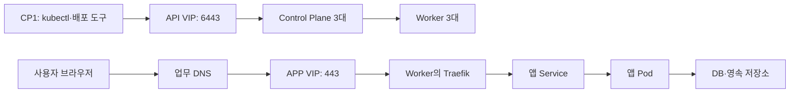

# 용어와 전체 구조

[가이드 홈](../README.md#클러스터) · 다음: [현재 환경 확인](baseline.md)

배포 문서에서 사용하는 Kubernetes 구성과 용어를 정리합니다. 명령 사용법은 [kubectl 명령어](kubectl.md)를 참고합니다.

## 접속·배포 경로

- 노드 구성은 [서버 목록](../infrastructure/servers.md#서버-목록)을 따릅니다. `khinfow01`의 Worker 추가는 사용자 확인이며 Ready·실제 앱 배치는 별도 조회가 필요합니다.
- 목표 구성에서는 APP VIP가 TCP 연결을 전달하고 Traefik이 TLS를 종료합니다.
- APP VIP backend는 [네트워크 원본](../infrastructure/network.md#vipdns접속-경로)에 기록된 Worker입니다. Worker 추가만으로 backend가 늘어나지 않습니다.
- 실제 LB 설정·backend 응답·Keycloak DNS 전환 여부는 별도 확인이 필요합니다.
- Control Plane이나 Traefik이 여러 대여도 앱 DB가 자동으로 복제되지 않습니다.

## 용어

| 용어 | 뜻 |
| --- | --- |
| Cluster | Kubernetes가 관리하는 서버와 제어 시스템 전체 |
| Node / Control Plane / Worker | 서버 / 클러스터 관리 노드 / 앱 실행 노드 |
| kubelet / 런타임 / CNI | 노드의 Pod 관리 / 컨테이너 실행 / Pod 네트워크 |
| etcd | 클러스터 상태 저장소. 앱 DB와 별도 백업 대상 |
| Namespace | 앱 리소스의 구역. 예: Keycloak의 `etch-sso` |
| Pod | 컨테이너 실행 단위 |
| Deployment / StatefulSet | Pod 개수·상태 관리 / 안정적인 이름·저장소 연결 관리 |
| Job / CronJob / DaemonSet | 완료되는 작업 / 주기 작업 / 선택한 각 노드에서 실행하는 작업 |
| Service / Ingress / Traefik | 앱 내부 접속점 / 도메인·경로 규칙 / 규칙에 따라 요청을 전달하는 Ingress Controller |
| ConfigMap / Secret | 일반 설정 / 비밀 설정을 전달하는 리소스 |
| TLS Secret | Ingress Controller가 사용할 인증서와 개인키를 저장하는 Secret |
| PV / PVC / StorageClass | 저장 공간 / 저장 공간 요청 / 저장소 공급 정책 |
| manifest / Kustomize | 리소스 YAML / 공통 YAML과 환경별 설정 합성 |
| Helm chart / release | 설치 묶음 / 설치된 인스턴스 |
| kubeconfig / context | 접속 설정 / 사용할 클러스터·계정·기본 Namespace 조합 |

## 파일이 앱으로 실행되는 순서

1. Git 원본과 실제 env·인증서·이미지·차트를 준비합니다.
2. 입력과 렌더 결과를 검사합니다.
3. 배포 도구가 Kubernetes에 리소스를 등록합니다.
4. 노드가 이미지를 받아 Pod를 실행합니다.
5. HTTPS·로그인·업무 기능을 확인합니다.

`git pull`이나 검사 통과만으로는 배포되지 않습니다. 관리 리소스가 있는 Pod는 삭제해도 다시 생성되며,
Secret 변경만으로 DB 계정의 비밀번호가 바뀌지 않습니다.
