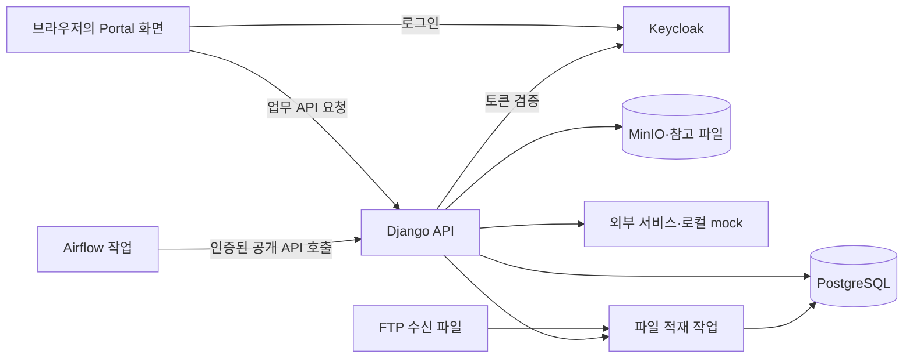

# 전체 아키텍처

[개념 안내](README.md) · [문서 홈](../README.md) · [용어 안내](04-glossary.md)

Tailwind는 업무 화면을 제공하는 Portal과, 로그인·작업 실행·파일 저장을 담당하는 서비스를 함께 관리합니다.
Portal은 브라우저에서 실행되는 React 화면과 Django API로 구성됩니다.
메일·Assistant·설비 조회 등 업무 기능은 Portal 안에서 기능 단위로 나눠 개발합니다.

이 문서에서는 서비스 관계와 데이터 흐름을 먼저 설명합니다.
정확한 화면·API·모델 이름은 [구현 색인](../reference/02-inventory.md), 수정 규칙은 [개발 안내](../development/README.md)에서 확인합니다.

## 구성 요소

| 구성 요소 | 하는 일 | 개발 PC에서의 실행 |
| --- | --- | --- |
| Portal Web | 업무 화면을 보여주고 사용자 입력을 API에 전달 | kind의 Web 또는 별도 Vite 개발 서버 |
| Portal API | 요청의 인증·권한을 검사하고 업무 데이터를 조회·변경 | kind의 Django API |
| Keycloak | 로그인과 앱 역할·SDWT 그룹 관리 | 로컬 Keycloak과 테스트 계정 |
| PostgreSQL | 사용자·업무 데이터·처리 이력 저장 | kind 밖의 별도 Docker 컨테이너 |
| MinIO | 메일 첨부·이미지 등 파일 저장·조회 | 로컬 객체 저장소 |
| Airflow | DAG에 정의된 수집·적재·요약·메일 작업 실행 | 로컬 Airflow가 Portal 공개 API 호출 |
| 외부 서비스 | RAG 검색·답변 생성·메일·Jira 등 연동 | 대부분 `local/adfs_dummy`가 대체 |
| FTP·Monitoring·Headlamp | 파일 수신, 지표 수집, Kubernetes 조회·관리 | 각 앱의 로컬 구성으로 실행 |

로컬 전체 환경은 한 PC에서 동작합니다. `make dev`로 앱을 실행하고,
기동 도구는 별도 Job으로 DB migration과 개발 데이터 준비를 수행합니다.
설정·계정·영속 데이터는 [로컬 안내](../../local/README.md)를 기준으로 확인합니다.

## 앱 소유 경로

하나의 앱에 필요한 파일을 세 영역에서 관리합니다. 예를 들어 Portal 화면을 바꾸는 코드는
`apps/portal/web`, 서버 설치 입력은 `deploy/portal`, 개발 PC 전용 설정은 `local/portal`에 있습니다.

| 영역 | 책임 | 시작점 |
| --- | --- | --- |
| `apps/<app>` | 직접 개발하는 소스·이미지·검사 도구 | [Portal](../../apps/portal/README.md), [Airflow](../../apps/airflow/README.md) |
| `deploy/<app>` | 서버 배포·공통 정의·CI 입력 | [서버 배포 안내](../../deploy/README.md) |
| `local/<app>` | 개발 PC의 차이·mock·실행 도구 | [로컬 실행 안내](../../local/README.md) |

공통 정의를 `deploy`에 두고 `local`에서 재사용합니다. 앱·서버 선택 그룹의 원본은 `deploy/shared/apps.json`입니다.
서버는 준비된 이미지와 배포 파일만으로 동작하며, 소스 빌드가 필요할 때만 `--with-source`로 소스를 추가합니다.

## 요청 흐름

메일 목록을 여는 경우를 예로 들면 다음 순서로 동작합니다.

1. 브라우저가 메일 화면을 표시하고, 해당 기능의 hook이 조회를 요청합니다.
2. API client가 `/api/v1/**` 경로로 Django API를 호출합니다.
3. View가 로그인·앱 접근·입력을 확인하고 업무 계층을 호출합니다.
4. 조회는 selector, 쓰기·트랜잭션·외부 호출은 service가 담당합니다.
5. DB·파일·외부 서비스에서 얻은 결과를 API가 반환하고 화면은 React Query의 조회 결과로 표시합니다.

서버에서 온 데이터를 UI 상태 저장소에 다시 복제하지 않습니다. 필터 패널 열기·선택 행 등 화면 조작 상태만
컴포넌트나 기능 내부 Zustand에 보관합니다. [Web 개발](../development/01-frontend.md)과 [API 개발](../development/02-backend.md)에서 세부 책임을 확인합니다.

## 핵심 데이터 흐름

### 인증과 소속

사용자는 Keycloak으로 로그인합니다. API가 로그인 토큰을 검증하고 EPID 사용자 정보를 갱신한 뒤,
검증된 앱 역할·SDWT 그룹을 로그인 세션에 저장합니다.
앱을 열 수 있는 권한과 해당 앱에서 조회·수정할 데이터 범위는 별도로 검사합니다.
역할·그룹 변경은 재로그인 후 반영됩니다. 기존 DB 소속·권한 테이블과 Django 관리자 플래그는 로그인 권한의 원천이 아닙니다.
세부 규칙은 [Auth](../modules/01-auth.md)와 [Account](../modules/02-account.md)를 확인합니다.

### 메일과 RAG

Emails가 POP3 또는 Mail API로 메일을 수집하고, 메일함·세션 권한에 따라 접근 범위를 제한합니다.
첨부·이미지는 MinIO에 저장합니다. 검색 자료 등록·삭제가 필요하면 DB의 `EmailOutbox`에 작업을 쌓고,
별도 처리기가 RAG 서비스에 전달합니다. Assistant는 검색 결과를 답변 생성의 근거로 사용합니다.
[Emails](../modules/03-emails.md)와 [Assistant](../modules/04-assistant.md)에서 세부 흐름을 확인합니다.

### Drone SOP 알림

메일 수집이나 Airflow 호출로 작업을 시작하고, 대상 line·소속·채널·수신자·전송 규칙을 계산합니다.
Jira·Messenger·Mail 채널별 실행과 전달 결과를 DB에 기록합니다.
Line Dashboard는 SOP 상태·이력·알림 설정을 조회·수정합니다.
[Line Dashboard / Drone](../modules/05-line-dashboard.md)에서 설정과 발송 결과의 관계를 확인합니다.

### 파일 적재와 Observer 조회

FTP 등으로 수신한 완료 파일을 Data Movement가 읽어 PostgreSQL 테이블로 적재합니다.
Observer는 line·SDWT·공정·설비 조건에 맞는 기준정보와 로그를 기본 DB에서 읽습니다.
API가 EQP·TIP·CTTTM·RACB·Drone 등의 로그를 공통 형태로 반환하면 화면이 타임라인과 상세 패널에 표시합니다.
[Data Movement](../modules/13-data-movement.md)와 [Observer](../modules/06-observer.md)에서 처리 순서와 원천 시간 해석을 확인합니다.

## 경계 규칙

코드의 기능 경계는 내부 구현을 서로 직접 참조하지 않도록 유지합니다.
Web은 feature의 `index.js` 공개 진입점을, API는 selector 또는 service facade를 사용합니다.
Web의 허용된 기능 간 의존 방향과 API 계층별 책임은 각각 [Web 개발](../development/01-frontend.md#feature-경계),
[API 개발](../development/02-backend.md#책임-분리)에 정리되어 있습니다.

외부 URL과 인증값은 env로 주입합니다. 사내 서비스 연결을 바꾸면 개발 PC의 대응 설정·mock도 함께 확인합니다.
[외부 연동](03-integrations.md)에는 서비스별 역할과 확인할 계약이 있습니다.

## 상세 색인

- 데이터가 남는 위치와 모델 관계: [데이터 모델과 저장소](02-data-model.md)
- 개별 기능의 화면·권한·처리 흐름: [기능 안내](../modules/README.md)
- 요청·응답·인증·오류: [API 명세](../api/README.md)
- 실제 경로·설정·관리 명령: [참고 자료](../reference/README.md)
